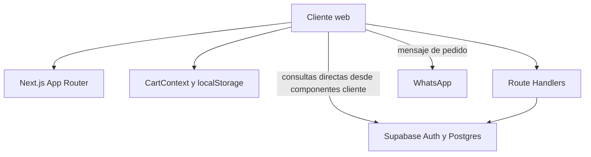

# Contexto Integral del Proyecto: DELTA Perfumería

Documento de traspaso técnico y funcional basado en el código presente en el repositorio. Describe el propósito, la arquitectura, las rutas, los flujos de negocio y las diferencias entre módulos implementados y plantillas pendientes. El esquema definitivo de Supabase no puede confirmarse solo con este repositorio porque no contiene migraciones SQL.

---

## 1. Contexto y propósito

DELTA es una tienda digital de perfumería de alta gama, presentada como una boutique de Bogotá con envíos nacionales. La aplicación ofrece una portada, un catálogo de fragancias, carrito y registro de pedidos que se finalizan contactando a la tienda por WhatsApp. También incluye un panel administrativo inicial para consultar pedidos y administrar inventario.

El proyecto está en evolución. Hay páginas funcionales conectadas a Supabase, otras con datos de ejemplo y algunos módulos/endpoints que todavía son placeholders. En particular, existen dos modelos de catálogo que no están unificados.

---

## 2. Stack y estructura

### Stack principal

- Next.js 16.4 con App Router y Route Handlers.
- React 19 y TypeScript.
- Tailwind CSS 4 para estilos y Lucide React para iconos.
- Supabase Auth y Postgres, usando `@supabase/ssr` y `@supabase/supabase-js`.
- WhatsApp como canal de confirmación de pedidos.

### Árbol funcional resumido

```text
app/
├── (auth)/                 # login y registro
├── admin/                  # dashboard, pedidos, inventario, productos
├── api/                    # endpoints de Next.js
├── catalogo/               # segunda vista de catálogo
├── components/
│   ├── admin/              # vistas administrativas
│   ├── auth/               # formularios de sesión
│   ├── catalog/            # flujo de carrito/pedido alternativo
│   ├── layout/             # componentes de navegación
│   └── recommendation/     # recomendador de fragancias
├── context/                # estado global del carrito
├── tienda/                 # tienda, carrito y redirección de checkout
├── nosotros/
├── test/                   # página de prueba del recomendador
├── globals.css
├── layout.tsx
└── page.tsx
lib/
├── supabase/               # clientes de navegador, servidor y middleware
├── db.ts                   # cliente Supabase directo
└── firebase.ts             # inicialización de Firebase, aparentemente sin uso
public/
```

El [layout raíz](app/layout.tsx) fija el idioma español, carga Inter y envuelve todas las páginas en `CartProvider`. La configuración de Next está en [next.config.ts](next.config.ts); el estilo global parte de [app/globals.css](app/globals.css).

### Arquitectura de solicitudes



Hay acceso a Supabase tanto directamente desde componentes cliente como desde handlers del servidor. El carrito no se almacena en Supabase: vive en el navegador.

---

## 3. Rutas y pantallas

| Ruta | Archivo principal | Función y estado |
|---|---|---|
| `/` | [app/page.tsx](app/page.tsx) | Portada de la marca; consulta sesión y muestra enlaces según el rol guardado en metadatos. |
| `/nosotros` | [app/nosotros/page.tsx](app/nosotros/page.tsx) | Presentación de la marca, ubicación y horarios. |
| `/login` | [app/(auth)/login/page.tsx](app/(auth)/login/page.tsx) | Formulario de acceso con Supabase Auth. |
| `/registro` | [app/(auth)/registro/page.tsx](app/(auth)/registro/page.tsx) | Registro por email y contraseña; guarda `full_name` en metadatos de Auth. |
| `/tienda` | [app/tienda/page.tsx](app/tienda/page.tsx) | Catálogo de `productos`, búsqueda/filtros, carrito y acceso al drawer de pedido. Si no obtiene productos, usa una lista fija de ejemplo. |
| `/tienda/carrito` | [app/tienda/carrito/page.tsx](app/tienda/carrito/page.tsx) | Resumen del carrito y formulario de cliente; abre WhatsApp e intenta insertar el pedido. |
| `/tienda/checkout` | [app/tienda/checkout/page.tsx](app/tienda/checkout/page.tsx) | Redirige a `/carrito`; no implementa un checkout propio. |
| `/catalogo` | [app/catalogo/page.tsx](app/catalogo/page.tsx) | Vista alternativa de productos con suscripción realtime; su botón de añadir al carrito no está conectado. |
| `/admin` | [app/admin/page.tsx](app/admin/page.tsx) | Resumen de ventas, pedidos y productos consultando Supabase desde el cliente. |
| `/admin/pedidos` | [app/admin/pedidos/page.tsx](app/admin/pedidos/page.tsx) | Lista y actualiza pedidos; escucha inserciones y actualizaciones realtime. |
| `/admin/inventario` | [app/admin/inventario/page.tsx](app/admin/inventario/page.tsx) | CRUD básico de productos/stock en la tabla `productos`. |
| `/admin/productos` | [app/admin/productos/page.tsx](app/admin/productos/page.tsx) | Usa `ProductosView`, otro catálogo que opera sobre `perfumes` e `inventory`. No está enlazado desde el menú lateral actual. |
| `/test` | [app/test/page.tsx](app/test/page.tsx) | Página de prueba del recomendador. |

El layout administrativo está en [app/admin/layout.tsx](app/admin/layout.tsx). Su menú enlaza dashboard, pedidos e inventario; incluye cerrar sesión y volver a la tienda.

---

## 4. Autenticación y acceso

- Login y registro usan el cliente de navegador de [lib/supabase/client.ts](lib/supabase/client.ts).
- El login valida con `signInWithPassword`. Lee el rol desde `user_metadata.role` o `app_metadata.role`; si es `admin`, redirige a `/admin`, y en otro caso a `/tienda`.
- El registro guarda el nombre como `full_name` en los metadatos de Supabase Auth.
- [middleware.ts](middleware.ts) crea un cliente SSR y llama a `supabase.auth.getUser()` para sincronizar la sesión en cookies. No redirige por falta de sesión ni comprueba el rol.
- El layout de admin tampoco valida la sesión/rol antes de renderizar. Ocultar enlaces en la portada no constituye una protección de acceso.

Por lo tanto, la autorización efectiva para lecturas/escrituras directas depende de las políticas RLS configuradas en Supabase. No hay migraciones ni políticas SQL en este repositorio con las que verificarlo.

---

## 5. Datos y contratos observables

No se incluyen tipos centralizados de base de datos ni archivos de esquema. Los siguientes campos se deducen de las consultas y escrituras del código.

### `productos`

La tienda principal espera campos como `id`, `name`, `brand`, `family`, `price`, `description` y opcionalmente `stock`. Inventario y formularios administrativos también insertan/actualizan `stock` y esos atributos. El ordenamiento presupone `created_at` en ciertas vistas.

### `pedidos`

El flujo de carrito envía `cliente_nombre`, `cliente_telefono`, `direccion`, `items`, `total` y `estado`. El panel consulta la tabla y usa `created_at`, `cliente_nombre`, `cliente_email`, `items`, `total` y `estado`. Esto revela contratos no alineados entre escritura y visualización.

En el checkout, los elementos del arreglo `items` contienen `name`, `price` y `quantity`; la pantalla administrativa tipa `cantidad`. Los valores de estado también varían en capitalización: el checkout envía `Pendiente`, mientras el panel presenta valores en minúsculas (`pendiente`, `enviado`, etc.).

### Segundo modelo: `perfumes` e `inventory`

[ProductosView](app/components/admin/ProductosView.tsx) gestiona una estructura diferente: tabla `perfumes` con atributos como `type`, `intensity`, `duration_hours`, `budget_category`, `occasion`, `climate_preference` e `is_active`, y tabla `inventory` con `perfume_id`, `stock_quantity`, `cost_price` y `selling_price`.

El recomendador también consulta `perfumes`. No se ve en este repositorio una sincronización entre `perfumes`/`inventory` y `productos`, por lo que parecen modelos paralelos.

---

## 6. Flujos de negocio

### Pedido desde la tienda

1. La página `/tienda` carga `productos` desde Supabase o usa un catálogo de ejemplo.
2. El usuario añade artículos al `CartContext`; el estado se persiste en `localStorage` mediante la clave `delta_cart`.
3. En el drawer o la página de carrito se solicitan nombre, teléfono y dirección.
4. El navegador construye un mensaje con cantidades y total calculados en cliente, y abre WhatsApp.
5. El navegador intenta insertar el pedido directamente en Supabase. No hay una validación de precio/cantidad en servidor en este flujo.

El drawer de [CartDrawer](app/components/CartDrawer.tsx), la vista [CatalogView](app/components/catalog/CatalogView.tsx) y la página de carrito mantienen implementaciones similares del flujo, pero no idénticas.

### Operación administrativa

- Dashboard: suma `pedidos.total` y cuenta filas de `pedidos` y `productos`.
- Pedidos: consulta la tabla directamente, escucha cambios realtime y actualiza `estado`.
- Inventario: consulta, crea, actualiza y elimina filas de `productos`; también escucha cambios realtime.
- Productos: la vista `/admin/productos` trabaja con el modelo independiente `perfumes`/`inventory`.

### Recomendador

El asistente solicita presupuesto, familia, ocasión y clima, pero la consulta actual a `perfumes` filtra por presupuesto y tipo. Las demás respuestas no afectan la selección final todavía.

---

## 7. API e integraciones

### Route Handlers

| Endpoint | Implementación actual |
|---|---|
| `/api/pedidos` | GET lista, POST inserta, PUT actualiza estado y DELETE elimina en Supabase mediante cliente de servidor. No se observa validación de rol/autorización en el handler. |
| `/api/auth/confirm` | Verifica un OTP de Supabase y redirige a la tienda o a una ruta de error. |
| `/api/auth/[...supabase]` | Respuesta de plantilla `ok: true`; no implementa un callback completo. |
| `/api/productos` y `/api/productos/status` | Placeholders que responden `ok: true`. |
| `/api/inventario` | Placeholder que responde `ok: true`. |
| `/api/dashboard/resumen` | Placeholder que responde `ok: true`. |
| `/api/configuracion` | Placeholder que responde `ok: true`. |
| `/api/recetas` | Placeholder que responde `ok: true`. |
| `/api/usuarios/verificar` | Placeholder; el comentario indica que falta implementar RBAC. |
| `/api/webhooks/stripe` | Placeholder; no verifica firma ni actualiza pedidos. |

### Servicios externos y configuración

- **Supabase** es la integración activa para Auth, Postgres y realtime. Los clientes usan `NEXT_PUBLIC_SUPABASE_URL` y `NEXT_PUBLIC_SUPABASE_ANON_KEY` (con alguna alternativa publishable en el cliente).
- **WhatsApp** es el canal actual de confirmación de pedido; el número destino está fijado en los componentes de carrito.
- **Stripe** aparece solo como ruta webhook incompleta; no hay pago integrado.
- **Firebase** tiene una inicialización en [lib/firebase.ts](lib/firebase.ts), pero no encontré referencias a ella y `firebase` no aparece en las dependencias de [package.json](package.json).

Hay valores alternativos de Supabase escritos en los clientes/middleware, por lo que conviene configurar explícitamente las variables de entorno por ambiente. No encontré un `.env.example`.

---

## 8. Componentes administrativos y estado de avance

Las páginas admin actualmente conectadas son dashboard, pedidos e inventario. `/admin/productos` también existe, aunque opera sobre otro esquema.

Varios componentes presentes en `app/components/admin/` son placeholders con texto `TODO`: `DashboardView`, `ConfiguracionView`, `UsuariosView`, `ReportesView` y `VentasView`. Los módulos de `app/components/admin/dashboard/` existen, pero no se aprecia en las rutas listadas que formen el dashboard principal actual.

[AdminClientPage](app/admin/AdminClientPage.tsx) parece una implementación alternativa/anterior de gestión de productos; la ruta `/admin` no la importa.

---

## 9. Riesgos e inconsistencias conocidas

1. **Protección del panel y API:** middleware/layout no exigen autenticación o rol admin. Los handlers de pedidos tampoco comprueban permisos. La seguridad de operaciones directas depende de RLS de Supabase, que no está versionada aquí.
2. **Modelos duplicados:** conviven `productos` y `perfumes`/`inventory`, sin sincronización visible.
3. **Contratos de pedido divergentes:** campos de cliente, forma de `items` y capitalización de estados no coinciden entre carrito y panel.
4. **Total confiado al navegador:** el precio, cantidades y total llegan desde el cliente y no se recalculan en servidor.
5. **Catálogos duplicados/incompletos:** `/tienda`, `/catalogo`, `CatalogView` y `AdminClientPage` presentan enfoques distintos; `/catalogo` no añade artículos al carrito.
6. **Endpoints incompletos:** la mayoría de rutas API no ejecutan lógica real y el webhook de Stripe no procesa pagos.
7. **Documentación y pruebas:** el README sigue siendo la plantilla de Next.js. No encontré pruebas automatizadas, esquema SQL ni migraciones en el workspace.

---

## 10. Desarrollo local

Scripts definidos en `package.json`:

```bash
npm run dev
npm run build
npm start
npm run lint
```

Variables de entorno principales:

- `NEXT_PUBLIC_SUPABASE_URL`
- `NEXT_PUBLIC_SUPABASE_ANON_KEY` (o `NEXT_PUBLIC_SUPABASE_PUBLISHABLE_KEY` en el cliente)

No se incluye documentación de aprovisionamiento de Supabase ni SQL para crear las tablas requeridas.

---

## 11. Orden sugerido para familiarizarse con el código

1. [app/page.tsx](app/page.tsx) y [app/tienda/page.tsx](app/tienda/page.tsx): experiencia pública y catálogo principal.
2. [app/context/CartContext.tsx](app/context/CartContext.tsx) y [app/components/CartDrawer.tsx](app/components/CartDrawer.tsx): persistencia del carrito y generación del pedido.
3. [app/admin/layout.tsx](app/admin/layout.tsx), [app/admin/pedidos/page.tsx](app/admin/pedidos/page.tsx) y [app/admin/inventario/page.tsx](app/admin/inventario/page.tsx): operación administrativa.
4. [lib/supabase/client.ts](lib/supabase/client.ts), [lib/supabase/server.ts](lib/supabase/server.ts) y [middleware.ts](middleware.ts): integración y sesión.
5. [app/api/pedidos/route.ts](app/api/pedidos/route.ts): API de pedidos disponible en servidor.
